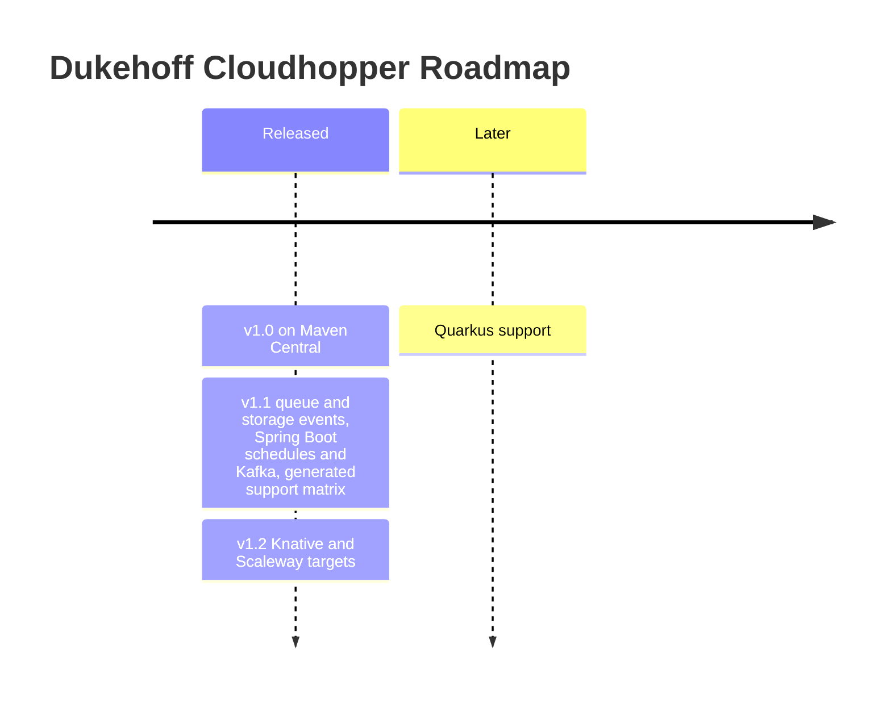

# Project Roadmap

What we plan next, in order. We don't publish dates; releases are announced on
[GitHub](https://github.com/dukehoff-gmbh/dukehoff-cloudhopper/releases).

## Released

### 1.2

- New target `knative`: a Helm chart for any Kubernetes cluster with Knative
  Serving and Eventing; schedules as `PingSource`, queues from Kafka with a
  dead-letter topic
- New target `scaleway-terraform`: Scaleway Serverless Containers via
  Terraform; cron triggers and Scaleway Queues with a dead-letter queue
- Both new targets run the Spring Boot application and are certified by the TCK
- GCP applies `@Function(minInstances)`
- The TCK now checks every attribute a target claims; claims without an
  implementation were removed, so the build warns about them
- Targets can claim single values of an attribute, such as
  `@EventTrigger(source = QUEUE)`; the support matrix shows them

### 1.1

- `@EventTrigger` for queues and storage buckets on all four targets, with
  `EventMetadata` and at-least-once delivery
- Spring Boot: executable jar from the archetype, a direct endpoint
  `/functions/<function name>` for every function, `@ScheduledTrigger`
  (in-process and `POST /schedules/<function name>`), queues from Kafka
- The Spring Boot target is certified by the TCK like the cloud targets
- Generated [support matrix](platforms/generator-overview#support-matrix) and
  build warnings for anything a target ignores
- [API reference](pathname:///api/index.html) (Javadoc) on this site

Missing something you need? Open an
[issue](https://github.com/dukehoff-gmbh/dukehoff-cloudhopper/issues).
