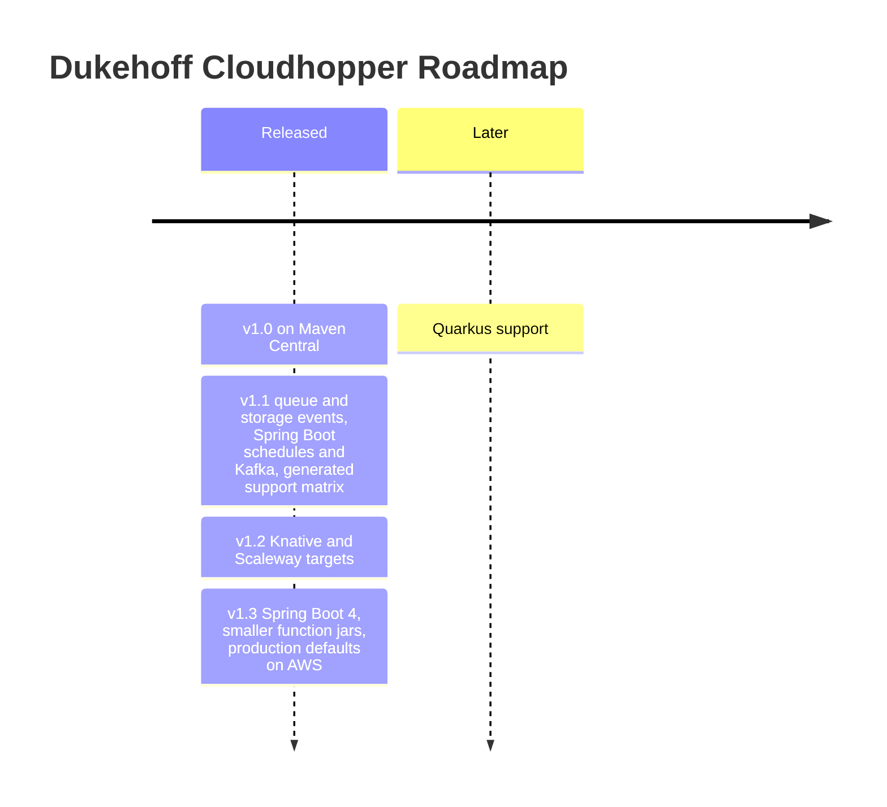

# Project Roadmap

What we plan next, in order. We don't publish dates; releases are announced on
[GitHub](https://github.com/dukehoff-gmbh/dukehoff-cloudhopper/releases).

## Released

### 1.3

- Spring Boot 4.1 for the targets `springboot-http`, `knative` and
  `scaleway-terraform`
- Smaller function jars: the generator is a build-time dependency, and the
  function only needs the API and a small runtime library per cloud
  (`provider-aws`, `provider-azure`, `provider-gcp`). The AWS runtime no longer
  uses the AWS SDK v1
- AWS: the API is served on the `$default` stage, Terraform manages the log
  groups with a retention (`log_retention_days`), and new variables for the
  stage and the artifact bucket
- The generated Terraform declares the Terraform versions it supports; the
  archetype adds provider version constraints to `main.tf`
- Projects created with the archetype deploy without changes
- Generated handlers support parameterized types and methods that declare
  checked exceptions
- Request data is no longer written to the function log

#### Upgrading from 1.2

- **Dependencies:** add the generator in `provided` scope and the runtime
  library of the cloud, e.g. `provider-aws`; see the
  [AWS generator](modules/generator-aws-terraform#1-add-the-maven-dependency)
- **Spring Boot targets:** the application needs Spring Boot 4: replace
  `spring-boot-starter-web` with `spring-boot-starter-webmvc`, and for Kafka add
  `spring-boot-starter-kafka`; see
  [Spring Boot](platforms/generator-overview#spring-boot-springboot-http)
- **AWS:** URLs no longer contain `/test`; set `api_stage_name = "test"` to keep
  them. Import the existing log groups once before the next `apply`; see
  [AWS](platforms/generator-overview#aws-aws-terraform)
- **Terraform:** add provider version constraints to your `main.tf`; see
  [Terraform and provider versions](platforms/generator-overview#terraform-and-provider-versions)

### 1.2

- New target `knative`: a Helm chart for any Kubernetes cluster with Knative
  Serving and Eventing; schedules as `PingSource`, queues from Kafka with a
  dead-letter topic
- New target `scaleway-terraform`: Scaleway Serverless Containers via
  Terraform; cron triggers and Scaleway Queues with a dead-letter queue
- Both new targets run the Spring Boot application and are certified by the TCK
- GCP applies `@Function(minInstances)`
- The TCK now checks every attribute a target claims; claims without an
  implementation were removed, so the build warns about them
- Targets can claim single values of an attribute, such as
  `@EventTrigger(source = QUEUE)`; the support matrix shows them

### 1.1

- `@EventTrigger` for queues and storage buckets on all four targets, with
  `EventMetadata` and at-least-once delivery
- Spring Boot: executable jar from the archetype, a direct endpoint
  `/functions/<function name>` for every function, `@ScheduledTrigger`
  (in-process and `POST /schedules/<function name>`), queues from Kafka
- The Spring Boot target is certified by the TCK like the cloud targets
- Generated [support matrix](platforms/generator-overview#support-matrix) and
  build warnings for anything a target ignores
- [API reference](pathname:///api/index.html) (Javadoc) on this site

Missing something you need? Open an
[issue](https://github.com/dukehoff-gmbh/dukehoff-cloudhopper/issues).
