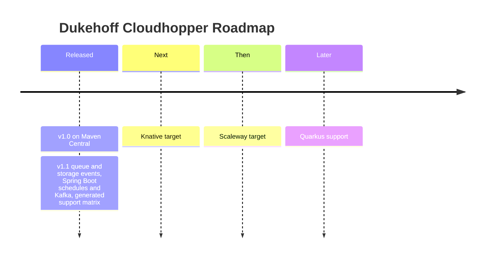

# Project Roadmap

What we plan next, in order. We don't publish dates; releases are announced on
[GitHub](https://github.com/dukehoff-gmbh/dukehoff-cloudhopper/releases).

## Released

### 1.1

- `@EventTrigger` for queues and storage buckets on all four targets, with
  `EventMetadata` and at-least-once delivery
- Spring Boot: executable jar from the archetype, a direct endpoint
  `/functions/<function name>` for every function, `@ScheduledTrigger`
  (in-process and `POST /schedules/<function name>`), queues from Kafka
- The Spring Boot target is certified by the TCK like the cloud targets
- Generated [support matrix](platforms/generator-overview#support-matrix) and
  build warnings for anything a target ignores
- [API reference](pathname:///api/index.html) (Javadoc) on this site

Missing something you need? Open an
[issue](https://github.com/dukehoff-gmbh/dukehoff-cloudhopper/issues).
